# Encrypting Azure SQL Database: TDE, Cell-Level Encryption and Always Encrypted

A DP-300 lab on one Terraform-built environment: **where each feature encrypts, and who can still read the data.**

**What you will prove**
- ✅ **TDE:** the database is encrypted at rest with your own Key Vault key.
- ✅ **CLE:** one column is encrypted. The admin can decrypt it, a non-admin can't until granted.
- ✅ **Always Encrypted:** bank columns encrypted in place inside a secure enclave. A database admin without Key Vault access sees only ciphertext.

**Tools used**

Most of the lab was run from the IDE: SQL queries, scripts and the evidence recordings all come from VS Code.

| Tool | Used for |
|---|---|
| Whizlabs cloud sandbox | The temporary Azure subscription the lab runs in |
| Terraform | Builds the Key Vault, keys, SQL server, database, TDE and logging |
| Azure SQL Database | `cle-database`, the target for TDE, CLE and Always Encrypted |
| VS Code (MSSQL extension) | Runs the T-SQL, shows the query results and is the source of the screen recordings |
| Azure CLI | Looks up resources, reads Key Vault secrets and issues access tokens (`az account get-access-token`) |
| sqlcmd | Runs the table scripts from [deploy-secure-table.sh](deploy-secure-table.sh) |
| Entra ID access token | Signs `sqlcmd` into SQL, and lets PowerShell call Key Vault, without a stored password |
| PowerShell (SqlServer module) | Creates the Always Encrypted keys and encrypts columns with `Set-SqlColumnEncryption` |

> **Structure:** the Terraform in [terraform/](terraform/main.tf) uses three modules: [key_vault](terraform/modules/key_vault/main.tf) for keys, secrets and the certificate, [sql](terraform/modules/sql/main.tf) for the server, database, TDE and auditing, and [monitoring](terraform/modules/monitoring/main.tf) for the log storage and Key Vault logging.

---

## TDE (Transparent Data Encryption) with a Customer-Managed Key

Everything in this section is deployed by Terraform ([terraform/main.tf](terraform/main.tf) and [terraform/modules/](terraform/modules/)). No manual steps are needed.

### 1. What TDE does (and doesn't)

- Encrypts the database files, transaction log and backups **at rest**, in real time.
- Is **transparent**: no application or query changes.
- Does **not** protect data in use or in transit. Anyone who can query the database sees plaintext, including a DBA. For that, see Cell-Level Encryption and Always Encrypted.

### 2. Service-managed vs customer-managed key

| | Service-managed (default) | Customer-managed (this lab, "BYOK") |
|---|---|---|
| Protector key | Microsoft-managed certificate | ✅ RSA key in your Key Vault |
| Rotation | Automatic by Microsoft | ✅ You control it (this lab: auto-rotation on) |
| Revocation | Not possible | ✅ Disable or remove the key and the database becomes inaccessible |
| Audit | Limited | ✅ Key Vault can log every wrap/unwrap to storage (defined in [modules/monitoring](terraform/modules/monitoring/main.tf), not yet deployed) |
| Access control | Managed by Microsoft | ✅ You decide which identities can use the key (least-privilege access policy) |
| Operational effort | None | Higher: you own key availability and recovery |

✅ **Customer-managed key is the better fit for personalized security.** You own the key's lifecycle, access and revocation, which is why this lab uses it. The trade-off is operational effort: if the key or its access is lost, the database is inaccessible.

### 3. Key chain

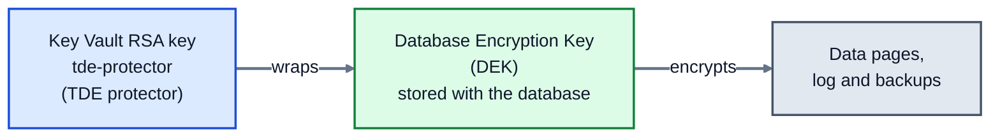

Rotating the protector only re-wraps the small DEK. The data is never re-encrypted.

### 4. How Terraform builds it

**You will see:** one `terraform apply` creates 15 resources, then each TDE piece is checked against what is actually deployed.

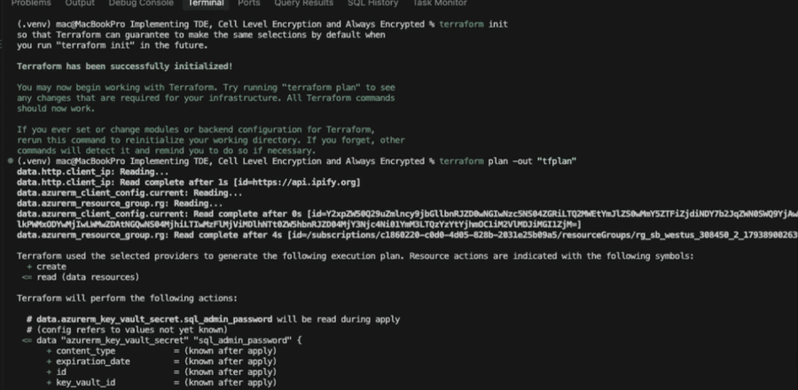

*init, plan, apply (1.5x). Ends with `Apply complete! Resources: 15 added, 0 changed, 0 destroyed.`*

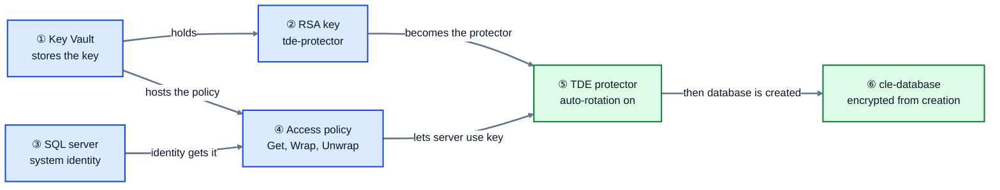


<details><summary>🔽 <b>Click to expand:</b> setup for the verify commands (run once from the project folder, stay in <code>terraform/</code>)</summary>

```bash
cd terraform
KV=$(terraform output -raw key_vault_name)
RG=$(terraform output -raw resource_group)
SQL=$(terraform output -raw sql_server_fqdn | cut -d. -f1)
PRINCIPAL=$(terraform output -raw sql_server_identity_principal_id)
```

</details>

#### ① Key Vault: purge protection is mandatory for a TDE protector

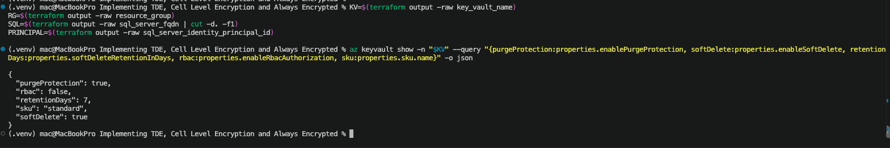

*Purge protection on, 7-day soft delete, access-policy model.*

<details><summary>🔽 <b>Click to expand:</b> Terraform code and verify command</summary>

Source: [terraform/modules/key_vault/main.tf lines 20-31](terraform/modules/key_vault/main.tf#L20-L31)

```hcl
resource "azurerm_key_vault" "kv" {
  name                       = var.name
  sku_name                   = "standard"
  rbac_authorization_enabled = false   # <<< vault access policy model
  purge_protection_enabled   = true    # <<< mandatory for a TDE protector
  soft_delete_retention_days = 7       # <<< minimum; cannot be changed later
  # ...
}
```

```bash
az keyvault show -n "$KV" --query "{purgeProtection:properties.enablePurgeProtection, softDelete:properties.enableSoftDelete, retentionDays:properties.softDeleteRetentionInDays, rbac:properties.enableRbacAuthorization, sku:properties.sku.name}" -o json
```

</details>

#### ② TDE protector key: RSA, limited to wrap and unwrap

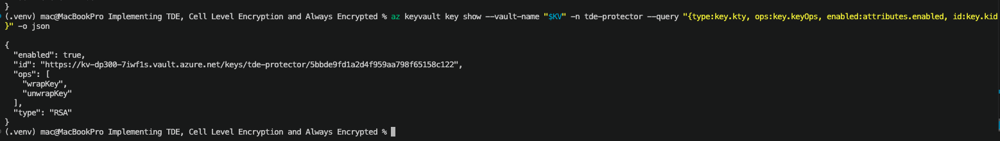

*RSA, enabled, `wrapKey` and `unwrapKey` only.*

<details><summary>🔽 <b>Click to expand:</b> Terraform code and verify command</summary>

Source: [terraform/modules/key_vault/main.tf lines 64-72](terraform/modules/key_vault/main.tf#L64-L72)

```hcl
resource "azurerm_key_vault_key" "tde" {
  name         = "tde-protector"
  key_vault_id = azurerm_key_vault.kv.id
  key_type     = "RSA"                       # <<<
  key_size     = 3072                        # <<< RSA 2048 or 3072 are supported
  key_opts     = ["wrapKey", "unwrapKey"]    # <<< only what TDE needs
}
```

```bash
az keyvault key show --vault-name "$KV" -n tde-protector --query "{type:key.kty, ops:key.keyOps, enabled:attributes.enabled, id:key.kid}" -o json
```

</details>

#### ③ SQL server identity: how the server authenticates to Key Vault

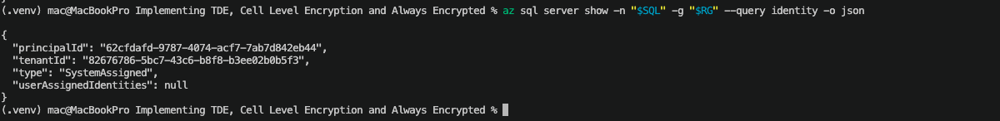

*System-assigned identity present, with a `principalId`.*

<details><summary>🔽 <b>Click to expand:</b> Terraform code and verify command</summary>

Source: [terraform/modules/sql/main.tf lines 15-46](terraform/modules/sql/main.tf#L15-L46)

```hcl
resource "azurerm_mssql_server" "sql" {
  name = var.server_name
  # ...
  identity {
    type = "SystemAssigned"   # <<< gives the server a principal ID for Key Vault
  }
}
```

```bash
az sql server show -n "$SQL" -g "$RG" --query identity -o json
```

</details>

#### ④ Access policy: least privilege, keys only

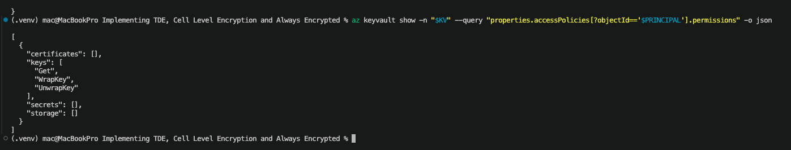

*Only `Get`, `WrapKey`, `UnwrapKey`. Secrets and certificates empty.*

<details><summary>🔽 <b>Click to expand:</b> Terraform code and verify command</summary>

Source: [terraform/modules/sql/main.tf lines 51-57](terraform/modules/sql/main.tf#L51-L57)

```hcl
resource "azurerm_key_vault_access_policy" "sql" {
  key_vault_id = var.key_vault_id
  tenant_id    = azurerm_mssql_server.sql.identity[0].tenant_id
  object_id    = azurerm_mssql_server.sql.identity[0].principal_id   # <<< the server's identity

  key_permissions = ["Get", "WrapKey", "UnwrapKey"]   # <<< no secret or certificate access
}
```

```bash
az keyvault show -n "$KV" --query "properties.accessPolicies[?objectId=='$PRINCIPAL'].permissions" -o json
```

</details>

#### ⑤ TDE protector: the Key Vault key becomes the server's protector

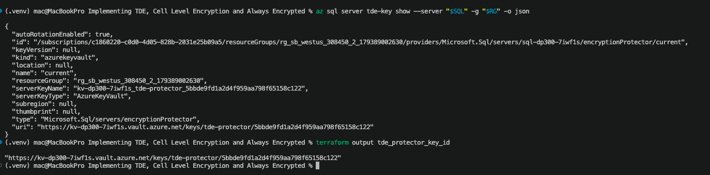

*`AzureKeyVault`, auto-rotation on, `uri` equals the Terraform output.*

<details><summary>🔽 <b>Click to expand:</b> Terraform code and verify command</summary>

Source: [terraform/modules/sql/main.tf lines 63-69](terraform/modules/sql/main.tf#L63-L69)

```hcl
resource "azurerm_mssql_server_transparent_data_encryption" "tde" {
  server_id             = azurerm_mssql_server.sql.id
  key_vault_key_id      = var.tde_key_id                 # <<< the protector
  auto_rotation_enabled = true                           # <<< picks up new key versions

  depends_on = [azurerm_key_vault_access_policy.sql]     # <<< policy must exist first
}
```

```bash
az sql server tde-key show --server "$SQL" -g "$RG" -o json
terraform output tde_protector_key_id
```

</details>

#### ⑥ Database: created after TDE, so it is encrypted from day one

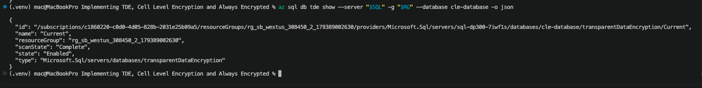

*TDE `state` is `Enabled` for `cle-database`.*

<details><summary>🔽 <b>Click to expand:</b> Terraform code and verify command</summary>

Source: [terraform/modules/sql/main.tf lines 75-86](terraform/modules/sql/main.tf#L75-L86)

```hcl
resource "azurerm_mssql_database" "db" {
  name      = var.database_name   # "cle-database"
  server_id = azurerm_mssql_server.sql.id
  # ...
  depends_on = [azurerm_mssql_server_transparent_data_encryption.tde]   # <<<
}
```

```bash
az sql db tde show --server "$SQL" -g "$RG" --database cle-database -o json
```

</details>

### 5. Verify it works

Inside the database:

```sql
SELECT DB_NAME(database_id) AS db, encryption_state, encryptor_type
FROM sys.dm_database_encryption_keys;
```

Expect `encryption_state = 3` (encrypted) and `encryptor_type = ASYMMETRIC KEY` for `cle-database`.

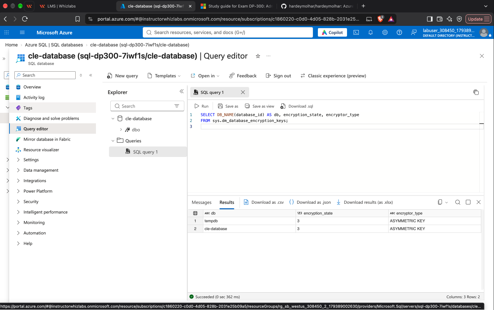

*Run in the portal query editor: both `cle-database` and `tempdb` report `encryption_state = 3` (encrypted) with an `ASYMMETRIC KEY` protector, which is the customer-managed key.*

The server-to-key link (`az sql server tde-key show`) is verified under ⑤ in section 4.

---

## CLE (Cell-Level Encryption) with a Certificate Imported from Key Vault

### 1. Overview

**Goal:** encrypt `Purchasing.Suppliers.BankAccountNumber` with keys **inside the database**. The certificate is created in **Key Vault** and imported into SQL.

| | TDE | CLE |
|---|---|---|
| Scope | Whole database | Chosen columns |
| App changes | None | Yes, T-SQL calls |
| Stops a DBA | ❌ | ❌ |

```mermaid
%%{init: {"theme":"base","themeVariables":{"fontFamily":"trebuchet ms, verdana, arial, sans-serif","fontSize":"16px","primaryColor":"#dbeafe","primaryTextColor":"#0f172a","primaryBorderColor":"#1d4ed8","lineColor":"#64748b","textColor":"#0f172a","clusterBkg":"#f8fafc","clusterBorder":"#94a3b8","titleColor":"#0f172a","edgeLabelBackground":"#ffffff"},"flowchart":{"nodeSpacing":50,"rankSpacing":65,"padding":18,"curve":"basis","htmlLabels":true}}}%%
flowchart LR
    A["Service Master Key<br/>(Azure)"] --> B["Database Master Key"]
    B --> C["Certificate<br/>CLE_Cert"]
    C --> D["Symmetric key<br/>CLE_Key (AES_256)"]
    D --> E["BankAccountNumberEnc<br/>varbinary(256)"]
    class A azure
    class B,C,D,E key
    classDef azure fill:#dbeafe,stroke:#1d4ed8,stroke-width:2px,color:#0f172a
    classDef key fill:#dcfce7,stroke:#15803d,stroke-width:2px,color:#0f172a
    classDef local fill:#e2e8f0,stroke:#475569,stroke-width:2px,color:#0f172a
    classDef user fill:#ffedd5,stroke:#c2410c,stroke-width:2px,color:#0f172a
    classDef bad fill:#fee2e2,stroke:#b91c1c,stroke-width:2px,color:#0f172a
    linkStyle default stroke:#64748b,stroke-width:2.5px
```

*Each key protects the next.* Code: [sql/export_import_cert_for_cle.sql](sql/export_import_cert_for_cle.sql) · Notes: [DP-300-CLE-notes.md](DP-300-CLE-notes.md)

### 2. Architecture

**Colours:** blue = Azure, green = keys and data, grey = Terraform and workstation, orange = people. **Labels** like A2 and B7 are step numbers from [sql/export_import_cert_for_cle.sql](sql/export_import_cert_for_cle.sql): A1 to A8 are the bash steps (Part A), B1 to B7 the T-SQL steps (Part B). Open that file to follow along.

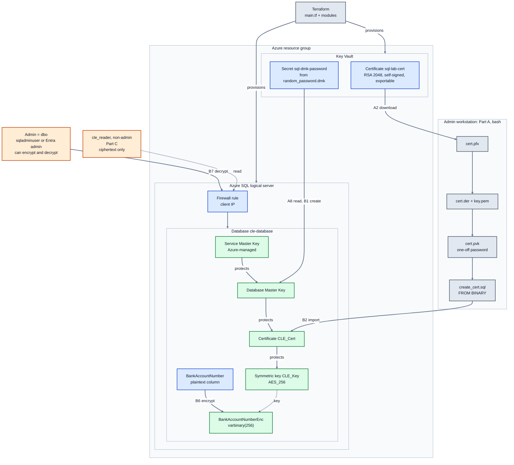

<details><summary>🔽 <b>Click to expand:</b> the same architecture as two smaller diagrams (if the one above is cropped in your viewer)</summary>

**Setup:** Terraform builds the Azure side, then the certificate travels from Key Vault to the database.

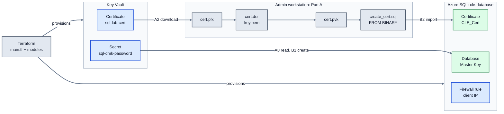

**Access:** the key chain inside `cle-database`, and what each user can do with it.

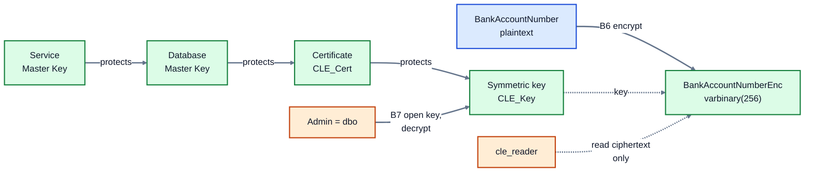

</details>

### 3. Source data

[sql/create_table.sql](sql/create_table.sql) creates the `Purchasing` schema, a `SupplierCategories` lookup table and `Purchasing.Suppliers`, then loads 500 fake supplier rows. `BankAccountNumber` is the column CLE protects.

### 4. Build steps: Part A (bash) and Part B (T-SQL)

The steps are in [sql/export_import_cert_for_cle.sql](sql/export_import_cert_for_cle.sql), numbered **A1 to A8** (bash, on your workstation) and **B1 to B7** (T-SQL, on `cle-database`). The architecture above shows where each one happens.

**Why the conversion?** Azure SQL Database can't read files, and `CREATE CERTIFICATE` accepts PVK, not PEM. So the certificate is converted to a PVK key plus a DER certificate, then pasted into SQL as binary.

> 🔒 **Delete `cert.pfx`, `key.pem`, `cert.pvk` and `create_cert.sql` after the import.** All four contain the private key. Never commit them.

<details><summary>🔽 <b>Click to expand:</b> Part A commands (A1 to A8, bash)</summary>

```bash
# A1. Private working folder (only you can access it)
mkdir -p -m 700 ~/cle && cd ~/cle

# A2. Download the certificate + private key from Key Vault (PFX)
KV=$(cd ~/Downloads/"Implementing TDE, Cell Level Encryption and Always Encrypted/terraform" && terraform output -raw key_vault_name)
az keyvault secret download --vault-name "$KV" --name sql-lab-cert --encoding base64 --file cert.pfx

# A3. Extract the public certificate as DER
openssl pkcs12 -in cert.pfx -passin pass: -nokeys -clcerts | openssl x509 -outform DER -out cert.der

# A4. Extract the private key as PEM (temporary, unencrypted)
openssl pkcs12 -in cert.pfx -passin pass: -nocerts -nodes -out key.pem

# A5. One-off password to protect the key on its way into SQL
PVK_PWD=$(openssl rand -hex 16)

# A6. Convert the private key to PVK, the format SQL accepts
openssl rsa -in key.pem -outform PVK -pvk-strong -passout pass:"$PVK_PWD" -out cert.pvk \
  -provider legacy -provider default

# A7. Write the CREATE CERTIFICATE statement to a file, then open it
printf "CREATE CERTIFICATE CLE_Cert\nFROM BINARY = 0x%s\nWITH PRIVATE KEY (BINARY = 0x%s, DECRYPTION BY PASSWORD = '%s');\n" \
  "$(xxd -p cert.der | tr -d '\n')" "$(xxd -p cert.pvk | tr -d '\n')" "$PVK_PWD" > create_cert.sql
code create_cert.sql

# A8. Get the DMK password (needed for B1)
az keyvault secret show --vault-name "$KV" --name sql-dmk-password --query value -o tsv
```

</details>

<details><summary>🔽 <b>Click to expand:</b> the core of CLE (B4 and B6, T-SQL)</summary>

```sql
CREATE SYMMETRIC KEY CLE_Key WITH ALGORITHM = AES_256 ENCRYPTION BY CERTIFICATE CLE_Cert;

OPEN SYMMETRIC KEY CLE_Key DECRYPTION BY CERTIFICATE CLE_Cert;
UPDATE Purchasing.Suppliers
   SET BankAccountNumberEnc = ENCRYPTBYKEY(KEY_GUID('CLE_Key'), BankAccountNumber)
 WHERE BankAccountNumber IS NOT NULL;
CLOSE SYMMETRIC KEY CLE_Key;
```

</details>

### 5. Admin baseline: the admin can do everything

**You will see:** connected as the Entra admin (`dbo`), every query works and the data decrypts.

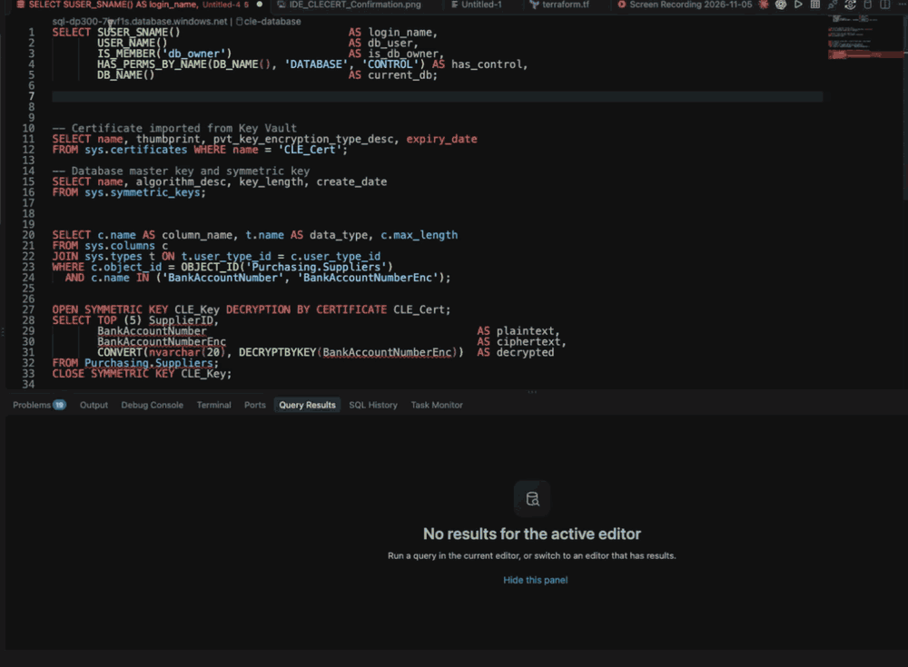

*1.75x. In order: identity, certificate, keys, column, decrypted rows.*

- ✅ **Identity:** `dbo`, `is_db_owner = 1`, `has_control = 1`
- ✅ **Keys present:** `CLE_Cert` (`ENCRYPTED_BY_MASTER_KEY`), the DMK and `CLE_Key` (AES_256)
- ✅ **Column:** `BankAccountNumberEnc` is `varbinary(256)`
- ✅ **Rows:** `decrypted` equals `plaintext`; `ciphertext` is unreadable bytes

**The imported certificate is the Key Vault one:** the thumbprints are identical.

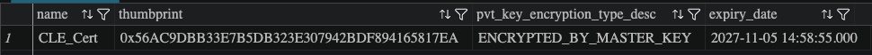

*Terraform reports the same value: from `terraform/`, `terraform output -raw certificate_thumbprint` gives `56AC9DBB33E7B5DB323E307942BDF894165817EA`.*

### 6. Non-admin test: `cle_reader` needs two grants to decrypt

**You will see:** the same data as a non-admin user, blocked one permission at a time. Tested from the admin session with `EXECUTE AS USER`. Script: [sql/non-admin.sql](sql/non-admin.sql).

```mermaid
%%{init: {"theme":"base","themeVariables":{"fontFamily":"trebuchet ms, verdana, arial, sans-serif","fontSize":"16px","primaryColor":"#dbeafe","primaryTextColor":"#0f172a","primaryBorderColor":"#1d4ed8","lineColor":"#64748b","textColor":"#0f172a","clusterBkg":"#f8fafc","clusterBorder":"#94a3b8","titleColor":"#0f172a","edgeLabelBackground":"#ffffff"},"flowchart":{"nodeSpacing":50,"rankSpacing":65,"padding":18,"curve":"basis","htmlLabels":true}}}%%
flowchart LR
    S["cle_reader<br/>reads ciphertext, but<br/>decrypt returns NULL"] -->|"open key"| E1["Msg 15151<br/>key not found"]
    E1 -->|"grant 1: key"| E2["Error:<br/>certificate not found"]
    E2 -->|"grant 2: cert"| OK["Decrypts"]
    OK -->|"revoke"| E3["Msg 15151<br/>again"]
    class S local
    class E1,E2,E3 bad
    class OK key
    classDef azure fill:#dbeafe,stroke:#1d4ed8,stroke-width:2px,color:#0f172a
    classDef key fill:#dcfce7,stroke:#15803d,stroke-width:2px,color:#0f172a
    classDef local fill:#e2e8f0,stroke:#475569,stroke-width:2px,color:#0f172a
    classDef user fill:#ffedd5,stroke:#c2410c,stroke-width:2px,color:#0f172a
    classDef bad fill:#fee2e2,stroke:#b91c1c,stroke-width:2px,color:#0f172a
    linkStyle default stroke:#64748b,stroke-width:2.5px
```

**grant 1:** `GRANT VIEW DEFINITION ON SYMMETRIC KEY::CLE_Key` · **grant 2:** `GRANT CONTROL ON CERTIFICATE::CLE_Cert`

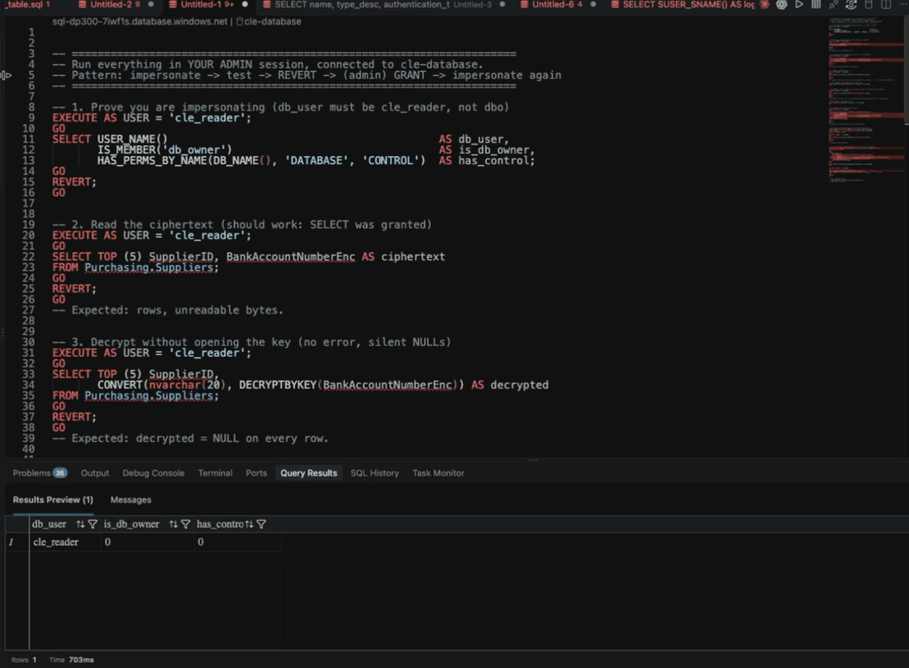

*2x. Follows the ladder above, left to right.*

| | Admin (`dbo`) | `cle_reader` |
|---|---|---|
| Reads ciphertext | ✅ | ✅ |
| Decrypts with no extra grants | ✅ | ❌ (`NULL` or an error) |
| Decrypts after key and certificate grants | n/a | ✅ |

- Seeing ciphertext is not reading data. Decryption needs the key **and** the certificate.
- CLE does not hide data from the admin. That is what Always Encrypted is for.

---

## Always Encrypted with Secure Enclaves: Encrypting Existing Data In Place

### 1. Overview

**Goal:** load `Purchasing.SuppliersSecure` as plaintext, classify it, then encrypt four bank columns **in place**, inside a secure enclave. After that, a database admin can only read ciphertext.

| | TDE | CLE | Always Encrypted |
|---|---|---|---|
| Scope | Whole database | Chosen columns | Chosen columns |
| Key usable by | Server | Database | ✅ Client, and the enclave when the client allows it |
| App changes | None | Yes, T-SQL calls | Yes, connection setting and parameters |
| Stops a DBA | ❌ | ❌ | ✅ |

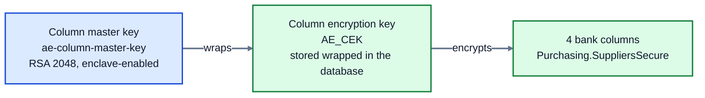

*The master key never leaves Key Vault. The database holds only its URL and the wrapped `AE_CEK`.*

### 2. Architecture

```mermaid
%%{init: {"theme":"base","themeVariables":{"fontFamily":"trebuchet ms, verdana, arial, sans-serif","fontSize":"16px","primaryColor":"#dbeafe","primaryTextColor":"#0f172a","primaryBorderColor":"#1d4ed8","lineColor":"#64748b","textColor":"#0f172a","clusterBkg":"#f8fafc","clusterBorder":"#94a3b8","titleColor":"#0f172a","edgeLabelBackground":"#ffffff"},"flowchart":{"nodeSpacing":50,"rankSpacing":65,"padding":18,"curve":"basis","htmlLabels":true}}}%%
flowchart LR
    KV["Key Vault<br/>column master key"]
    APP["Client<br/>PowerShell"]
    subgraph DB["cle-database"]
        ENC["Secure enclave<br/>encrypts in place"]
        TBL["SuppliersSecure<br/>ciphertext"]
    end
    DBA["Database admin<br/>no vault access"]

    KV -->|"unwraps AE_CEK"| APP
    APP -->|"hands AE_CEK over securely"| ENC
    ENC -->|"encrypts existing rows"| TBL
    TBL -.->|"ciphertext only"| DBA

    class KV azure
    class ENC,TBL key
    class APP local
    class DBA user
    classDef azure fill:#dbeafe,stroke:#1d4ed8,stroke-width:2px,color:#0f172a
    classDef key fill:#dcfce7,stroke:#15803d,stroke-width:2px,color:#0f172a
    classDef local fill:#e2e8f0,stroke:#475569,stroke-width:2px,color:#0f172a
    classDef user fill:#ffedd5,stroke:#c2410c,stroke-width:2px,color:#0f172a
    linkStyle default stroke:#64748b,stroke-width:2.5px
```

*Only the client talks to Key Vault. The enclave uses the key inside the server, where the DBA can't see it.*

### 3. With or without a secure enclave

| | Without enclave | With enclave (this lab) |
|---|---|---|
| Create an empty encrypted table | ✅ | ✅ Same |
| Insert new rows | Client encrypts | Client encrypts, same |
| Encrypt existing data | Client tool downloads every row, encrypts, re-uploads | ✅ Encrypted inside the database's enclave |
| Search randomized columns | ❌ | ✅ `=`, `LIKE`, ranges |
| Extra setup | None | VBS enclave and an enclave-enabled master key |

Creating an encrypted column only records rules, so it never needs the key. Encrypting existing data does, which is why it needs the client or the enclave.

### 4. Who needs which permission

| Who | Where | Permissions |
|---|---|---|
| Person creating the keys | Key Vault access policy | `create`, `get`, `list`, `sign`, `unwrapKey`, `wrapKey`, `verify` |
| Person creating the metadata | Database | `ALTER ANY COLUMN MASTER KEY`, `ALTER ANY COLUMN ENCRYPTION KEY` |
| Person encrypting in place | Database and Key Vault | `ALTER` on the table, plus the key permissions above |
| Anyone querying encrypted columns | Database | `VIEW ANY COLUMN MASTER KEY DEFINITION`, `VIEW ANY COLUMN ENCRYPTION KEY DEFINITION` |
| SQL server managed identity | Key Vault | None for Always Encrypted |

> ⚠️ **Lab shortcut:** vault access policies apply to every key in the vault. The server's TDE policy therefore also reaches `ae-column-master-key`, even though SQL never uses it. In production, keep the column master key in a separate vault.

> 📸 **Evidence to add:** `AE_CMK_Key_Confirmation.png`: the key is RSA, enabled, and allows `wrapKey`, `unwrapKey`, `sign` and `verify`.

> 📸 **Evidence to add:** `AE_Enclave_Enabled.png`: the database reports a `VBS` enclave.

<details><summary>🔽 <b>Click to expand:</b> Terraform code and verify commands</summary>

Source: [terraform/modules/key_vault/main.tf lines 75-83](terraform/modules/key_vault/main.tf#L75-L83)

```hcl
resource "azurerm_key_vault_key" "ae_cmk" {
  name         = "ae-column-master-key"
  key_vault_id = azurerm_key_vault.kv.id
  key_type     = "RSA"                                          # <<<
  key_size     = 2048                                           # <<<
  key_opts     = ["wrapKey", "unwrapKey", "sign", "verify"]     # <<< what the client driver needs
}
```

Source: [terraform/modules/sql/main.tf line 84](terraform/modules/sql/main.tf#L84)

```hcl
resource "azurerm_mssql_database" "db" {
  # ...
  enclave_type = "VBS"   # <<< secure enclave for in-place encryption
}
```

```bash
az keyvault key show --vault-name "$KV" -n ae-column-master-key --query "{type:key.kty, ops:key.keyOps, enabled:attributes.enabled, id:key.kid}" -o json
az sql db show --server "$SQL" -g "$RG" -n cle-database --query "{name:name, enclave:preferredEnclaveType}" -o json
```

</details>

### 5. Build steps

**You will see:** a plaintext table loaded and classified, then all four bank columns encrypted in place by PowerShell.

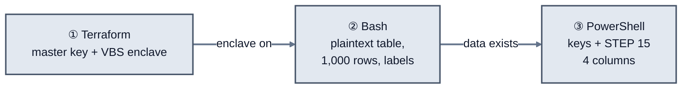

| Column | Protection | Why |
|---|---|---|
| `BankAccountNumber` | 🔐 Deterministic | Unique per supplier. Exact lookups and payment matching need equal ciphertext. |
| `BankInternationalCode` | 🔐 Deterministic | A public bank identifier (SWIFT/BIC). Grouping or joining by bank needs equal ciphertext, and repeats reveal little. |
| `BankAccountName` | 🔐 Randomized | Free-text personal data, never joined on. The enclave still allows `LIKE`. |
| `BankAccountCode` | 🔐 Randomized | Few distinct values. Deterministic would show which suppliers share a branch. |
| `PhoneNumber`, `CreatedBy` | 🎭 Dynamic data masking | Not encrypted |

**Rule of thumb:** deterministic leaks which rows share a value, so use it only where equality, joins or grouping are needed. Randomized is the safer default. With an enclave-enabled key it still supports `=`, `LIKE` and ranges inside the enclave. Deterministic string columns need a `*_BIN2` collation, which [sql/create_ae_table.sql](sql/create_ae_table.sql) already sets.

All four columns are encrypted by ③ PowerShell STEP 15.

#### ① Terraform

`terraform apply` turns on the VBS enclave. The code and checks are in section 4.

#### ② Create, load and classify

> 🔗 **Builds on the CLE base tables.** `Purchasing.SuppliersSecure` has a foreign key to `Purchasing.SupplierCategories`, the parent table created by [sql/create_table.sql](sql/create_table.sql) in [CLE section 3](#3-source-data). The parent must exist before the secure table, otherwise the create fails with *"Foreign key ... references invalid table 'Purchasing.SupplierCategories'"*.

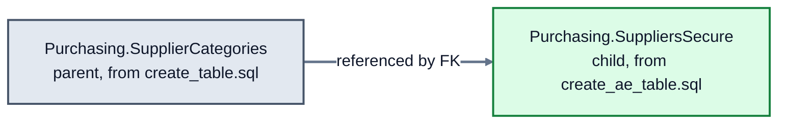

[deploy-secure-table.sh](deploy-secure-table.sh) gets an Entra access token, then runs [sql/create_table.sql](sql/create_table.sql) and [sql/create_ae_table.sql](sql/create_ae_table.sql). The table is created as plaintext and loaded with 1,000 rows by plain T-SQL, then classified. Classification comes **before** encryption, and section 6 checks it survives.

**Table deployment:** the deployment step that runs before any encryption.

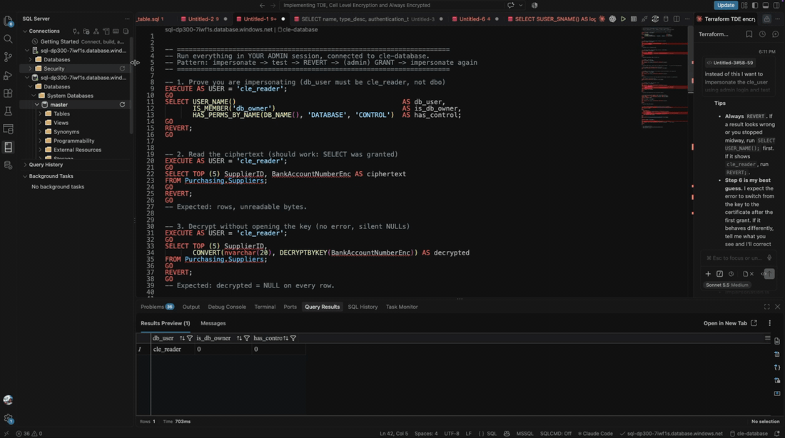

*2x. The deployment runs before any keys exist.*

**Plaintext before:** `Purchasing.SuppliersSecure` is queried before encryption, and the bank columns read as plain values.

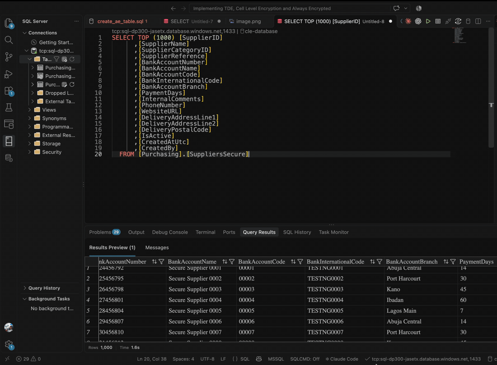

*Real time. Rows: 1,000.*

- ✅ **Bank columns readable:** `BankAccountNumber` (`24456792`), `BankAccountName` (`Secure Supplier 0001`), `BankAccountCode` (`00001`), `BankInternationalCode` (`TESTNG0001`)
- ✅ **This is the baseline:** section ③ encrypts these columns in place

#### ③ Keys, then the PowerShell route (STEP 15)

[Deploy-AlwaysEncryptedKeys.ps1.ps1](Deploy-AlwaysEncryptedKeys.ps1.ps1) creates an enclave-enabled `AE_CMK` and `AE_CEK`. STEP 15 then lists each column to encrypt, and `Set-SqlColumnEncryption` sends the key to the enclave. `-DisableFallBackToClientSide` makes it fail rather than quietly encrypting on the client instead.

**CMK and CEK deployed:** after STEPs 8 to 14, both keys are registered in the database, and the master key points at Key Vault with enclave computations allowed.

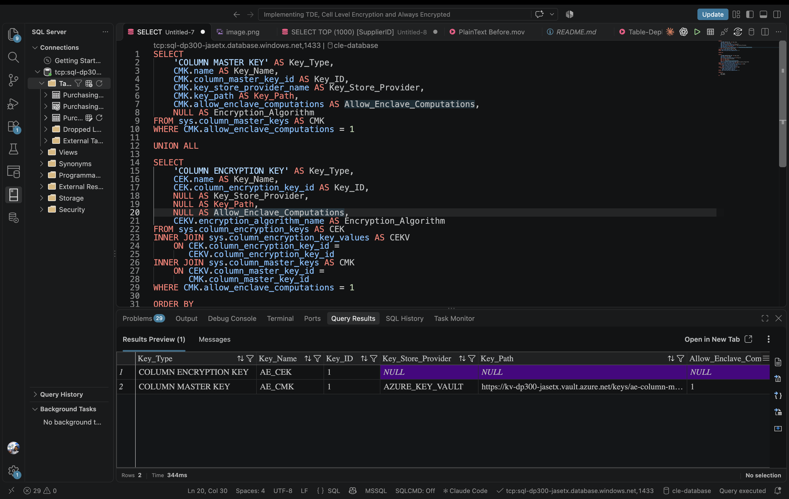

- ✅ **`AE_CMK`:** `AZURE_KEY_VAULT`, key path `https://kv-dp300-jasetx.vault.azure.net/keys/ae-column-master-key/...`, `Allow_Enclave_Computations = 1`
- ✅ **`AE_CEK`:** registered and wrapped by `AE_CMK` (the join only returns CEKs under an enclave-enabled CMK)

**Columns encrypted:** after the PowerShell deployment, the same table is queried in the Azure portal query editor, where Always Encrypted is not enabled.

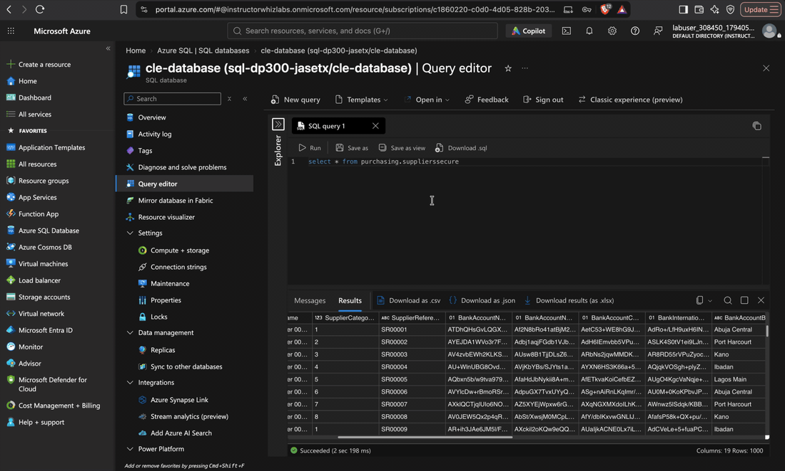

*Real time. Query editor, no column encryption setting.*

- ✅ **Bank columns:** ciphertext (for example `AdRo+/Lfh9uxH6l...`) where section ② showed `TESTNG0001`
- ✅ **Other columns:** `BankAccountBranch` and `PaymentDays` are unchanged and still readable
- ✅ **All 1,000 rows** were encrypted in place, with no reload

<details><summary>🔽 <b>Click to expand:</b> STEP 15 and the key checks</summary>

Source: [Deploy-AlwaysEncryptedKeys.ps1.ps1 STEP 15](Deploy-AlwaysEncryptedKeys.ps1.ps1)

```powershell
$columnSettings = @(
    New-SqlColumnEncryptionSettings `
        -ColumnName "Purchasing.SuppliersSecure.BankAccountNumber" `   # <<< which column
        -EncryptionType "Deterministic" `                              # <<< equality lookups
        -EncryptionKey $cekName
    # ... BankInternationalCode (Deterministic),
    #     BankAccountName and BankAccountCode (Randomized)
)

Set-SqlColumnEncryption `
    -InputObject $database `
    -ColumnEncryptionSettings $columnSettings `
    -KeyVaultAccessToken $keyVaultToken `
    -EnclaveAttestationProtocol None `     # <<< VBS enclave, no attestation
    -DisableFallBackToClientSide           # <<< enclave or nothing
```

```sql
SELECT name, key_store_provider_name, allow_enclave_computations, key_path
FROM sys.column_master_keys;

SELECT k.name, v.encryption_algorithm_name, v.encrypted_value
FROM sys.column_encryption_keys AS k
JOIN sys.column_encryption_key_values AS v
    ON v.column_encryption_key_id = k.column_encryption_key_id;
```

</details>

### 6. Verify: before and after

**You will see:** the same `SELECT` returning readable values before encryption, and ciphertext after it on a normal connection.

```sql
SELECT TOP (5) SupplierID, SupplierName,
       BankAccountNumber, BankAccountName, BankAccountCode, BankInternationalCode
FROM Purchasing.SuppliersSecure
ORDER BY SupplierID;

SELECT c.name, c.encryption_type_desc, sc.label AS sensitivity_label
FROM sys.columns AS c
LEFT JOIN sys.sensitivity_classifications AS sc
    ON sc.major_id = c.object_id AND sc.minor_id = c.column_id
WHERE c.object_id = OBJECT_ID(N'Purchasing.SuppliersSecure')
  AND c.name LIKE N'Bank%';
```

> 🎬 **Evidence to add:** `AE_Ciphertext_vs_Plaintext.gif`: the first query on a normal connection (ciphertext), then with `Column Encryption Setting=Enabled` (plaintext), then the second query showing `DETERMINISTIC` or `RANDOMIZED` with the labels still there.

### 7. The admin test: full database rights, no key

**You will see:** `sqladminuser` owns the database but has no Key Vault access, so it can only read ciphertext.

> 📸 **Evidence to add:** `AE_Admin_Ciphertext_Confirmation.png`: `SELECT SUSER_SNAME(), IS_ROLEMEMBER('db_owner')` and the section 6 query in one result, as `sqladminuser`.

| | Entra admin (has vault access) | `sqladminuser` (no vault access) |
|---|---|---|
| Is `db_owner` | ✅ | ✅ |
| Reads ciphertext | ✅ | ✅ |
| Reads plaintext | ✅ | ❌ |

### 8. Proof from Key Vault: the server never calls the master key

**You will see:** the Key Vault logs show your user calling `ae-column-master-key`, and the server's identity calling `tde-protector`. Logs can take up to 10 minutes to appear.

> 📸 **Evidence to add:** `AE_KeyVault_Caller_Logs.png`: the log entries for both keys, with the caller visible.

<details><summary>🔽 <b>Click to expand:</b> read the logs (from <code>terraform/</code>)</summary>

```bash
KV=$(terraform output -raw key_vault_name)
ST=$(terraform output -raw audit_storage_account_name)
KEY=$(az keyvault secret show --vault-name "$KV" --name audit-storage-key --query value -o tsv)

mkdir -p kv-logs
az storage blob download-batch --account-name "$ST" --account-key "$KEY" \
  --source insights-logs-auditevent --destination kv-logs

find kv-logs -name '*.json' -exec cat {} + \
  | jq -c 'select(.operationName | test("^Key(Wrap|Unwrap|Sign|Verify)")) | {time, operationName, key: .properties.id, caller: .identity.claim}'

rm -rf kv-logs
```

</details>

- Plaintext never leaves the client or the enclave, even while existing data is encrypted.
- Always Encrypted separates who manages the data from who can read it.
